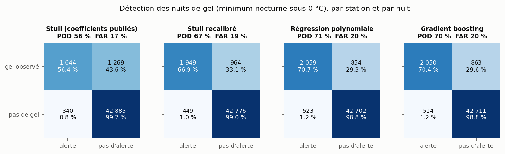
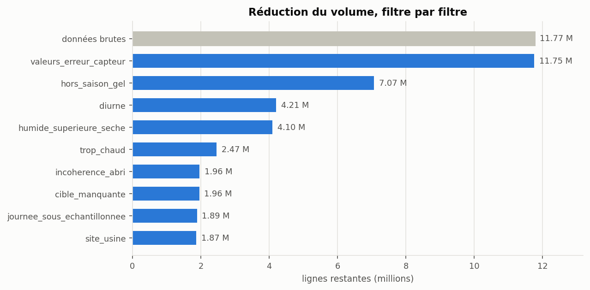
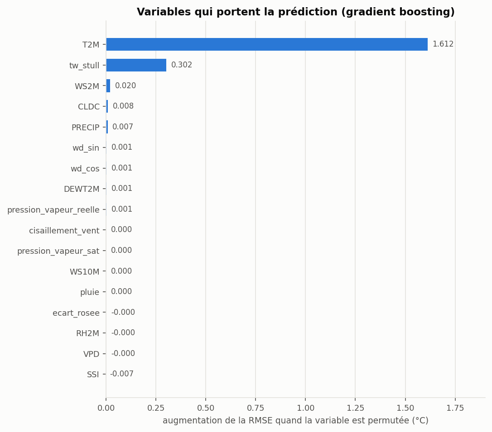
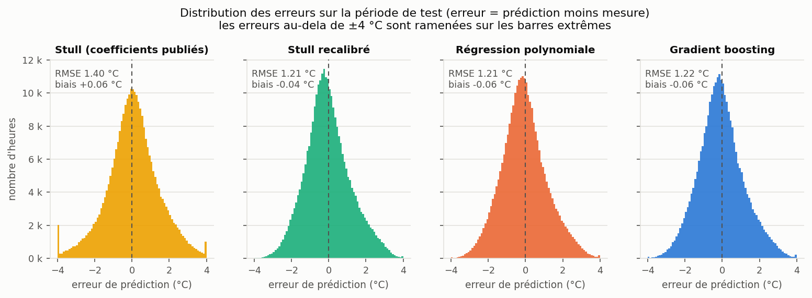
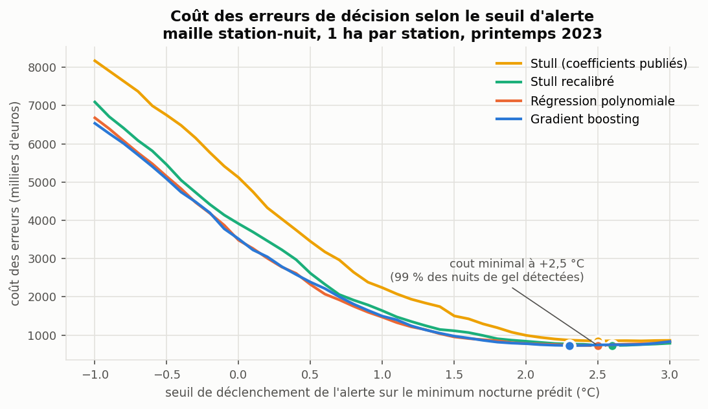
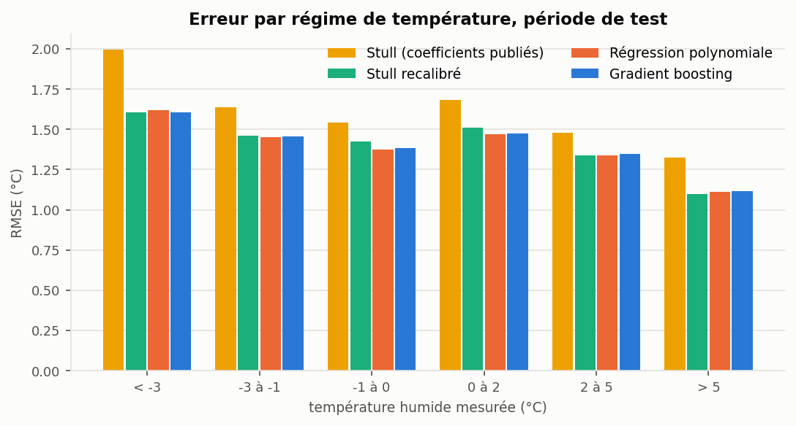

# Alerte gel : prédire la température humide en parcelle sans capteur

Reconstituer la température humide mesurée dans le couvert végétal, à 50 cm et
sans abri, à partir des seules variables atmosphériques estimées à 2 m. L'enjeu
est direct : cette grandeur décide du risque de gel et du déclenchement des
protections antigel, mais elle demande un capteur dédié dans chaque parcelle. Si
on sait la reconstituer, on peut servir une alerte là où il n'y a pas de
matériel.

Données réelles d'un réseau de stations agro-météo : **11,8 millions de mesures
horaires**, 1 739 capteurs, trois saisons de gel, 1,4 Go de CSV brut.

```bash
pip install -r requirements.txt
python -m gel tout          # chaine complète : 4 minutes
```

## Le résultat en bref

| Approche | RMSE test | Nuits de gel détectées | Fausses alertes |
| --- | --- | --- | --- |
| Formule de Stull recalibrée (4 coefficients) | **1,208 °C** | 66,9 % | 18,7 % |
| Régression polynomiale (170 termes) | 1,213 °C | **70,7 %** | 20,3 % |
| Gradient boosting (17 variables) | 1,218 °C | 70,4 % | 20,0 % |
| Formule de Stull, coefficients publiés | 1,402 °C | 56,4 % | 17,1 % |
| Référence sans modèle (Tw = T2M) | 1,886 °C | 31,2 % | 6,4 % |

Trois conclusions, toutes mesurées sur une saison jamais vue à l'apprentissage
(printemps 2023, 291 431 heures, 1 409 stations, 46 138 nuits de station) :

1. **Les trois approches se tiennent dans un centième de degré.** En comparant
   les modèles nuit par nuit, la meilleure ne gagne que 38 nuits sur 72, et
   l'écart qui la sépare de la deuxième est deux fois plus petit que la variation
   de cet écart d'une nuit à l'autre : elles ne sont pas départagées. Le gradient
   boosting avec dix-sept variables ne bat pas une formule physique à quatre
   coefficients, parce que la limite vient de l'information disponible dans les
   variables autorisées, pas du modèle.
2. **Le meilleur modèle au sens de la RMSE n'est pas celui qui détecte le mieux
   le gel.** La RMSE est dominée par les nuits douces, qui sont les plus
   nombreuses ; la détection ne se joue que dans la queue froide. La régression
   polynomiale détecte 110 nuits de gel de plus que la formule recalibrée tout en
   ayant une RMSE légèrement moins bonne.
3. **Le vrai levier n'est pas le modèle, c'est le seuil d'alerte.** Avec un cout
   de gelée ratée 33 fois supérieur à celui d'une fausse alerte, le seuil optimal
   est à +2,5 °C et non à 0 °C : le cout des erreurs baisse de 79 % et la
   détection passe à 99 %.

Recommandation de déploiement : la formule recalibrée, pas le modèle
d'apprentissage automatique. À performance équivalente, elle se calcule en
quelques opérations, se vérifie à la main par un agronome et se recalibre en une
seconde. Le raisonnement complet est dans la [note de décision](rapports/note_de_decision.md).

```
formule publiée    Tw = 0,2831 hr^0,2735 Ts + 3,018e-04 hr² + 0,01289 hr - 4,0962
formule recalibrée Tw = 0,2927 hr^0,2735 Ts + 3,818e-04 hr² - 0,04978 hr + 0,1973
```

Le coefficient principal bouge peu : ce qui change, c'est le terme constant, qui
passe de -4,10 à +0,20. La formule publiée décrit un psychromètre sous abri à
2 m, nos capteurs mesurent sans abri à 50 cm dans le couvert végétal. Le
recalibrage absorbe ce décalage de dispositif, et c'est tout ce qui lui
manquait : il gagne 0,19 °C de RMSE sur la formule d'origine et rejoint des
modèles bien plus riches.



## Le contexte métier

Le gel de printemps détruit les bourgeons après le débourrement. Les pertes se
comptent en récoltes entières, et les protections (aspersion, tours antigel,
chauffage) coutent cher à déclencher et ne servent à rien si l'alerte arrive trop
tard.

La grandeur qui gouverne cette décision est la température humide, mesurée à
hauteur de végétal et sans abri. Elle est plus basse que la température de l'air
sous abri, d'environ 1,3 °C en moyenne sur ce jeu de données, et c'est elle qui
dit si un bourgeon gèle. Elle commande aussi la protection par aspersion, qui ne
protège que si la température humide reste au-dessus d'un seuil critique, et qui
aggrave les dégats en dessous.

Le problème est qu'elle demande un capteur spécifique dans la parcelle. Les
variables atmosphériques à 2 m sous abri (température, point de rosée, humidité
relative, vent à 2 et 10 m, direction du vent, déficit de pression saturante,
nébulosité, rayonnement, précipitations) sont, elles, estimées partout. D'où la
question posée ici : avec quelle fiabilité peut-on reconstituer la première à
partir des secondes, et à quel seuil faut-il déclencher l'alerte ?

## Les données

| | |
| --- | --- |
| Volume brut | 11 773 387 mesures horaires, 1,4 Go |
| Capteurs | 1 739 identifiants de station |
| Période | 15 mars 2020 au 30 aout 2023 |
| Après nettoyage | 1 870 803 lignes (15,9 %), 1 537 stations |
| Cible | `T2M_U_med`, température humide horaire médiane à 50 cm, sans abri |
| Variables autorisées | les 10 variables atmosphériques à 2 m, et elles seules |

Les mesures sont agrégées par heure en médiane. La convention de datation est
piégeuse et elle est documentée : une mesure datée du 2 juin à l'heure 24 décrit
la période de 23 h à minuit du 2 juin, donc l'heure 24 d'un jour tombe à minuit
du jour suivant.

### Le nettoyage, et ce qu'il révèle

Neuf filtres, chacun implémenté comme une fonction testable qui renvoie le masque
des lignes à supprimer, avec un journal chiffré du volume retiré par règle
(`artefacts/journal_nettoyage.csv`).



Deux filtres méritent une attention particulière, parce que leur maille change
tout :

- **La santé capteur se juge à la journée, pas à l'heure.** La règle supprime les
  journées où une station a émis moins de 50 fois. Appliquée ligne à ligne, elle
  détruit des heures saines et laisse passer des journées défaillantes. Et le
  cumul doit être calculé sur les données brutes : si on le calcule après avoir
  retiré les heures diurnes, le cumul médian par station-jour tombe à 48, juste
  sous le seuil, et le filtre vide la moitié du jeu pour une raison purement
  artificielle. Ce détail d'ordre d'application vaut un million de lignes.
- **Le filtre du site de calibration est une distance, pas une égalité.** Les
  stations situées à moins de 0,05 degré du site de fabrication sont en test :
  130 stations, 123 753 lignes. Aucune n'a exactement les coordonnées du point de
  référence, donc une comparaison d'égalité ne retire rien.

Trois constats de qualité de données sont sortis de cette étape, aucun n'étant
mentionné dans la consigne :

- **`station_id` n'identifie pas un capteur de façon stable.** 365 identifiants
  sur 1 537 couvrent des positions séparées de plus de 0,01 degré, jusqu'à
  4 degrés de latitude : des identifiants sont réutilisés d'un site à l'autre.
  59 871 lignes brutes portent le même triplet (station, date, heure) avec des
  coordonnées et des mesures différentes.
- **Les variables fournies sont redondantes par construction.** Recalculer
  l'humidité relative depuis la température et le point de rosée redonne la
  colonne fournie à moins de 0,6 point près dans 95 % des cas, et le déficit de
  pression saturante à moins de 0,01 kPa près. Sur dix variables autorisées,
  trois disent la même chose. C'est l'explication du plafond de performance
  commun aux trois approches.
- **Des valeurs sentinelles survivent aux filtres de l'énoncé.** Un point de
  rosée à -46 °C n'est pas une mesure, c'est un code d'erreur. Le cas est
  résiduel (une ligne) mais tracé.

## La démarche

### Protocole d'évaluation

Découpage strictement chronologique, comme l'impose la consigne :

| Jeu | Lignes | Période | Part d'heures de gel |
| --- | --- | --- | --- |
| Apprentissage | 919 081 | 15/03/2020 au 31/05/2022 | 16,2 % |
| Validation | 660 291 | 01/11/2022 au 14/03/2023 | 21,4 % |
| Test | 291 431 | 15/03/2023 au 31/05/2023 | 3,7 % |

La validation est la dernière saison de la fenêtre d'apprentissage. Elle sert à
choisir les modèles et les hyperparamètres ; la période de test n'est touchée
qu'une fois, pour la mesure finale.

Un découpage aléatoire serait un piège ici, et le projet le chiffre : les
variables atmosphériques sont estimées sur une grille, donc deux stations
voisines à la même heure portent des entrées identiques. Un tirage aléatoire
place des lignes quasi jumelles des deux cotés de la séparation et fait gagner
3,9 % de RMSE qui n'existent pas en production.

La période de test est volontairement la plus exigeante : elle ne couvre que la
fin de la saison, avec cinq fois moins de gel que la saison de validation. Ce
sont justement les gelées tardives de printemps, les plus rares et les plus
couteuses.

### Les trois approches

1. **Formule de Stull simplifiée**, celle de l'énoncé, avec les coefficients
   publiés. Aucun apprentissage : c'est la performance atteignable sans projet
   data. Elle est doublée d'une **version recalibrée** sur les capteurs du jeu,
   qui répond à une question précise : la formule est-elle mal formée, ou
   simplement calibrée pour un abri à 2 m alors que nos capteurs mesurent à
   50 cm sans abri ? L'exposant de l'humidité reste celui publié, et comme la
   formule est alors linéaire en ses quatre coefficients, le recalibrage est une
   simple régression linéaire.
2. **Régression polynomiale**, « la plus pertinente possible » selon l'énoncé,
   ce qui veut dire sélectionnée et non décidée d'avance : 56 configurations
   (cinq jeux de variables, trois degrés, quatre niveaux de régularisation
   Ridge), choisies sur la validation. Le degré 2 sur le jeu complet gagne ; le
   degré 3 sur les dix variables brutes, avec ses 285 termes corrélés, perd
   0,08 °C.
3. **Gradient boosting** (`HistGradientBoostingRegressor`), sur les dix variables
   et sept variables dérivées. Choisi plutot qu'une foret aléatoire pour le cout
   d'exploitation : même performance, 90 secondes d'apprentissage, quelques
   mégaoctets de modèle.

Deux références de controle complètent le tableau : prédire la température humide
par la température sous abri, et la formule brute. Un modèle qui ne les bat pas
largement ne justifie pas sa mise en production.

### Les variables dérivées

Toutes construites à partir des dix variables autorisées, jamais de l'identifiant
de station, de l'heure ou de la position : un modèle qui utiliserait ces
informations ne saurait plus servir une parcelle sans capteur, ce qui est
pourtant le cas d'usage.

- direction du vent encodée en sinus et cosinus, parce que 359 et 1 degré sont
  voisins et qu'un arbre les traite autrement comme deux extrêmes ;
- pression de vapeur saturante et réelle (Tetens), écart au point de rosée ;
- estimation de Stull donnée comme variable d'entrée, de sorte que le modèle n'a
  plus qu'à apprendre la correction entre l'abri à 2 m et le capteur à 50 cm ;
- cisaillement de vent entre 2 et 10 m, indicateur de stratification nocturne.

L'importance par permutation est sans ambiguité : la température sous abri et
l'estimation de Stull font presque tout le travail, les autres variables
n'apportent presque rien. Ce n'est pas une surprise au vu de la redondance
constatée au nettoyage.



## Les résultats



Une RMSE de 1,21 °C ne suffit pas à décrire le service rendu. Trois lectures
complémentaires :

**L'erreur en degrés.** Elle dépasse 1 °C dans 39 % des heures et 2 °C dans 11 %.
Le biais global est quasi nul pour la formule recalibrée (-0,03 °C), ce qui
compte : un modèle qui surestime la température humide sous-estime le risque de
gel, et c'est la seule erreur réellement couteuse.

**La détection du gel, à la maille de la nuit.** Une gelée est un évènement
nocturne. Compter les erreurs à l'heure multiplie les pertes par la durée de
l'épisode, alors qu'une nuit de gel de six heures ne détruit la récolte qu'une
fois et ne déclenche le dispositif qu'une fois. Sur 46 138 couples station-nuit,
dont 2 913 nuits de gel, le meilleur modèle détecte 70,7 % des nuits avec 20 %
d'alertes injustifiées, contre 31 % de détection pour la référence sans modèle.

**Le cout des erreurs.** C'est là que la décision se prend.



Le seuil qui minimise le cout est à +2,5 °C sur le minimum nocturne prédit, et
non à 0 °C. Il fait passer la détection à 99 % et baisser le cout de 79 %, au
prix de deux alertes sur trois inutiles. Ce seuil ne dépend que du rapport entre
le cout d'une gelée ratée et celui d'une fausse alerte, pas des montants
absolus : le rapport de résultats donne la table pour des rapports de 5 à 100, de
sorte qu'un exploitant peut se situer sans chiffrer sa perte au centime.

### Où le modèle se trompe



L'erreur croit dans les régimes froids, c'est-à-dire exactement dans les
situations qui déclenchent une alerte. La RMSE moyenne n'est donc pas la
précision du produit la nuit où il sert, et c'est une limite qu'il faut annoncer
plutot que moyenner.

En revanche, la généralisation à de nouveaux capteurs tient : la période de test
contient 325 stations absentes de l'apprentissage, et leur erreur n'est pas
dégradée (1,15 °C contre 1,22 °C). Le modèle n'a pas appris le comportement de
capteurs particuliers mais une relation physique, ce qui est la condition pour
servir une parcelle nouvellement équipée.

Le rapport complet, avec tous les tableaux et les figures, est dans
[rapports/resultats.md](rapports/resultats.md). Chaque tableau y est accompagné
du nom du fichier de `artefacts/` d'où il sort, réécrit à chaque exécution de la
chaine. Et chaque choix de méthode est justifié dans
[docs/choix_techniques.md](docs/choix_techniques.md), y compris les options que
j'ai écartées et pourquoi.

## Limites

- Le modèle **reconstitue**, il ne prévoit pas. Branché sur une prévision
  météorologique, il hérite de l'erreur de cette prévision en plus de la sienne.
- Trois saisons de données, un seul printemps de test. Aucun évènement extrême
  dans l'échantillon.
- Les hypothèses de cout (4 000 € par hectare pour une gelée ratée, 120 € pour
  une alerte inutile) sont des ordres de grandeur paramétrables, pas des
  mesures. Elles servent à montrer le mécanisme d'arbitrage et sa sensibilité.
- Le jeu de données a été anonymisé et modifié par le fournisseur. Les valeurs
  absolues ne décrivent donc pas un réseau de capteurs réel.

## Reproduire

```bash
pip install -r requirements.txt

python -m gel ingestion      # CSV 1,4 Go vers Parquet typé (17 s, 141 Mo)
python -m gel nettoyage      # les 9 filtres + journal d'audit (7 s)
python -m gel modelisation   # apprentissage et évaluation des 3 approches (3 min)
python -m gel protocole      # découpage aléatoire contre chronologique
python -m gel pieges         # chiffrage des pièges méthodologiques
python -m gel tout           # la chaine complète (4 min)

python -m pytest             # 42 tests
```

Le chemin du CSV brut et tous les seuils sont dans `config/config.toml`. Aucune
valeur n'est codée en dur dans le code, et les étapes communiquent par fichiers,
ce qui permet de relancer la modélisation sans refaire le nettoyage.

## Structure

```
config/config.toml        chemins, seuils de nettoyage, découpage, hypothèses de cout
src/gel/
  config.py               lecture typée de la configuration
  io.py                   conversion CSV vers Parquet, lectures
  cleaning.py             les 9 filtres, un par fonction, et le journal d'audit
  features.py             physique (Tetens, Stull) et variables dérivées
  models.py               Stull brut et recalibré, polynomiale, gradient boosting
  metrics.py              erreur, détection du gel, cout de décision
  pipeline.py             enchainement et expériences de controle
  viz.py                  figures du rapport
  cli.py                  python -m gel <etape>
tests/                    42 tests, dont 7 de non-régression sur des erreurs réelles
docs/choix_techniques.md  chaque décision, sa justification, les options écartées
notebooks/
  demonstration.ipynb     le raisonnement en 5 étapes, sans réentrainement
  version_initiale_2024/  le rendu d'origine, conservé pour vérification
rapports/
  resultats.md            rapport détaillé, tableaux issus de artefacts/
  note_de_decision.md     note d'une page pour une équipe produit
  revue_de_la_version_initiale.md   ce qui n'allait pas dans la v1, et pourquoi
artefacts/                tableaux chiffrés produits par la chaine (CSV, JSON)
```

## Origine du projet, et pourquoi il a été repris

Ce travail part d'un test technique de data science que j'ai rendu en septembre
2024 pour une candidature en alternance. Je l'ai repris entièrement en octobre
2026, et la reprise a mis au jour trois erreurs qui invalidaient les
conclusions :

1. **Le modèle apprenait la mauvaise variable.** `T2M_D_med` (température sèche
   du capteur) au lieu de `T2M_U_med` (température humide). Le projet répondait à
   une autre question que celle posée, et rien dans les scores ne le signalait.
2. **La formule de Stull était évaluée contre elle-même.** La cible utilisée
   était la sortie de la formule, pas la mesure du capteur. D'où un R² de
   0,99999 qui ne mesurait rien. Confrontée aux mesures, la même formule obtient
   un R² de 0,73.
3. **Le protocole temporel imposé par l'énoncé n'était pas respecté.** Découpage
   aléatoire au lieu de chronologique, et les 291 431 lignes du jeu de test
   désigné n'ont jamais été utilisées.

S'y ajoutaient deux filtres de nettoyage appliqués à la mauvaise maille, une MSE
commentée comme une erreur en degrés, et un R² lu comme un taux d'erreur. Le
détail de chaque point, avec l'effet numérique de la correction, est dans
[rapports/revue_de_la_version_initiale.md](rapports/revue_de_la_version_initiale.md).

Ce document fait partie du projet, volontairement. Deux des trois erreurs
produisaient des résultats plausibles et n'auraient été détectées par aucun test
unitaire : savoir revenir sur son propre travail et chiffrer ce qu'une erreur a
couté fait partie du métier.

---

Ismael Foudjo, data scientist. Jeu de données anonymisé et modifié par son
fournisseur, utilisé ici dans un cadre pédagogique et de démonstration.
